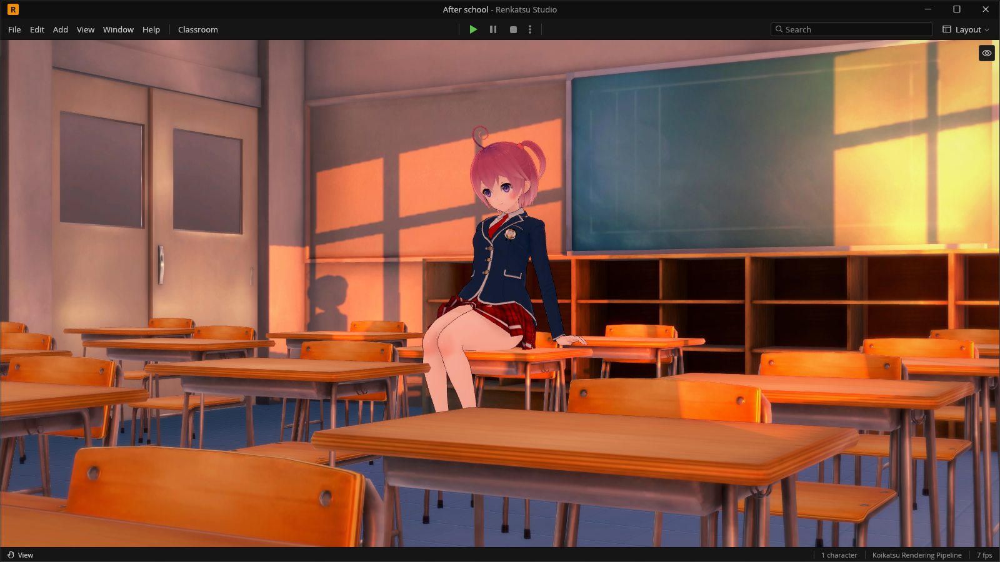
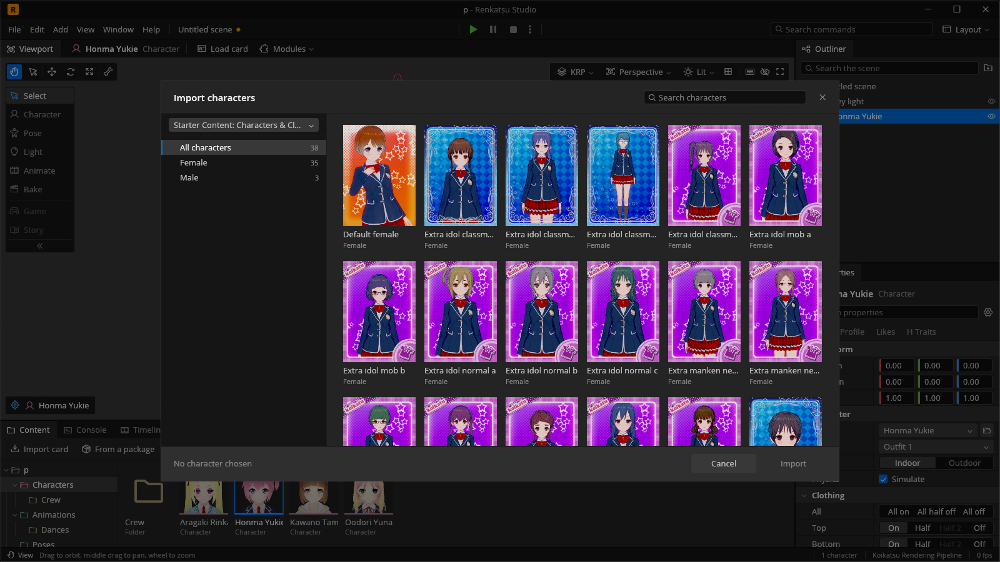
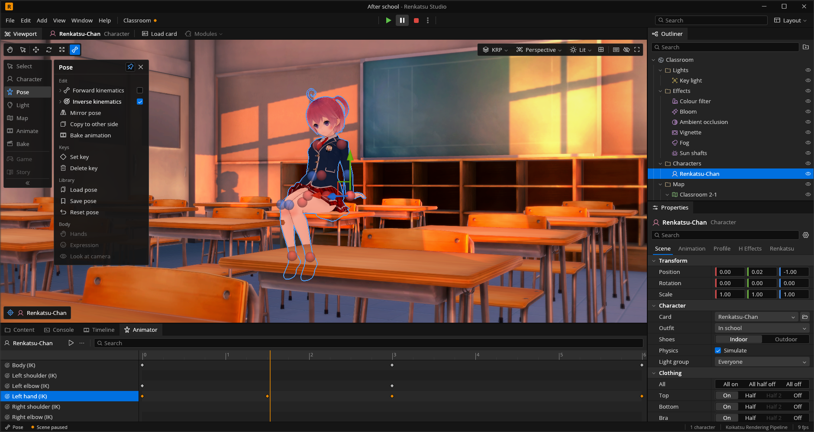

# Renkatsu

[](https://github.com/Mihnea8848/renkatsu/releases/latest)
[](https://github.com/Mihnea8848/renkatsu/releases)
[](#installation)
[](#requirements)
[](#license)

[](https://ko-fi.com/mihnea8848)

Renkatsu Studio is a scene editor for Koikatsu characters. Bring in your
cards, dress and animate them, put them in CharaStudio's maps, light the
scene and make your pictures, in a modern editor that runs on Windows and
Linux. Your characters look the way they do in the game, mods and plugin
data included.

You don't need Koikatsu. On first start Renkatsu offers Starter Content,
the game's own characters, clothing, animations and maps, as a free
download. If you have the game, Renkatsu reads your cards and mods from it
too, and never changes it.

<p align="center">
  
</p>

Get the installer from the
[latest release](https://github.com/Mihnea8848/renkatsu/releases/latest),
run it, and start a project.

## What you can do

### Bring your characters

- Import any Koikatsu character card. Renkatsu copies it into your project
  with every mod it needs, and tells you first how many there are and how
  much space they take.
- Characters look as they do in CharaStudio: the game's own shaders,
  colours, makeup, overlays, patterns and textures, with hair, skirt and
  bust physics. On my test cards the pictures match CharaStudio's at about
  99% per pixel.
- The plugin data cards carry works too: MaterialEditor, MoreAccessories,
  ABMX, Pushup, Uncensor Selector, Stiletto heels and fifteen more.
- Each character keeps who it is beside how it looks: name, personality,
  birthday, club, traits and likes, which you can change per scene without
  touching the card.

<p align="center">
  
</p>

### Dress and animate them

- Clothing switches on, half off and off per piece, with the game's rules
  for which pieces go together.
- 5728 animations with a Koikatsu folder, or 3860 from Starter Content:
  standing, sitting, talking, dancing, fighting and the H scenes, named in
  English, with a live preview before you add them.
- Play, pause and stop run the animations and the physics together.

### Pose and animate them

- Pose a character by hand. Turn any bone with its handle, as in
  CharaStudio's FK, or move her hands, feet, elbows, knees and body with
  IK and let the rest follow. IK is CharaStudio's own solver, so a pose
  lands where it would in the game.
- Start from any frame of an animation, mirror a pose or copy one side to
  the other, and keep your poses in the project to use again.
- Set keys on bones and IK targets and play them on the timeline, with
  smooth, even or held easing. Play one character's animation on its
  own while you work on it, and save it to give to another character.

<p align="center">
  
</p>

### Build the scene

- CharaStudio's 42 maps, from the classrooms and the pool to the park and
  the train, at day, evening or night, with their lighting, shadows, sky,
  reflections and walls that get out of the camera's way.
- Move a map's furniture, open and close its doors, and turn its sun with
  Ctrl+L.
- Lamps of your own that cast shadows, characters that shade the map, and
  CharaStudio's look: colour filters, bloom, ambient occlusion, fog, depth
  of field, sun shafts and mirrors.
- Move, turn and scale anything with gizmos, snap it to the floor or a
  grid, and attach props to other objects or to a character's hand.

### Keep your work together

- A project is a plain folder holding its characters, animations, maps,
  scenes and the mods they need, so you can copy it, back it up or open
  it on another computer.
- Undo and redo for everything, and shortcuts you can change.
- Renkatsu tells you when a new version is out and installs it for you.

## Coming next

Hand shapes, facial expressions and where a character looks, then
characters stored whole in the project, so a project opens the same
without Koikatsu or its mods.

## Why I made this

Koikatsu is no longer developed. The community keeps it alive with patches
and mods on an old Unity version, and that has limits nobody can fix from
the outside.

Visual novels made with Koikatsu characters have the same problem. The
usual way is to pose a scene in CharaStudio, take a screenshot and put the
image in Ren'Py. After that the image is dead: if a character changes
later, every old scene has to be opened and rendered again. I want scenes
that stay live, so a change to a character shows up everywhere it is used.

That needs an engine that understands Koikatsu content on its own. This is
my attempt at one: written from scratch in Rust, drawn with wgpu, with no
Unity code and no patching of the game.

## Roadmap

Renkatsu will be one app with two parts: Renkatsu Studio for scenes, and
later Renkatsu Character Maker with everything the Koikatsu maker can do.

1. Character look: Koikatsu shaders, card colours, texture compositing,
   overlays and the other plugin data that cards depend on. Done in 0.1.0,
   with CharaStudio's screen effects in 0.1.2
2. The studio: a docked editor with a viewport, scene tree and inspector,
   and scene and project files stored as readable text, done in 0.1.1.
   Packages and Starter Content, so Renkatsu works without Koikatsu, came
   in 0.1.2, and posing by hand with CharaStudio's FK and IK in 0.2.3.
   Next in this step: hands, faces and gaze, and characters kept in the
   project in Renkatsu's own format
3. The Ren'Py link: baked images and video that are rendered again when a
   character changes
4. Animation
5. Maps from glTF and FBX files, and a Renkatsu map format for sharing
6. The character maker
7. Games in real 3D for desktop and Android
8. Koikatsu Sunshine content
9. Renkatsu's own shading: a modern anime look in the spirit of games such
   as Arknights: Endfield, offered beside the Koikatsu look. This comes
   last, once the engine, the editor and the main features are done

The default look will stay anime style, with real shadows and better
lighting than the game has.

## Known problems

- Hand shapes, facial expressions and gaze can't be posed yet, and
  CharaStudio's pose files can't be imported
- Without a Koikatsu install, characters come from Starter Content only.
  Cards that use mods need the mods, which come with a Koikatsu install
- Maps from mods are not read yet
- Koikatsu Sunshine content is not supported

## Version history

The latest version is 0.2.3, on the
[releases page](https://github.com/Mihnea8848/renkatsu/releases).

<details>
<summary>What each version brought</summary>

- 0.1.0 covered character import. Renkatsu builds a character from a card
  the way Koikatsu and its plugins do, and draws it with the game's
  shaders. On 41 reference cards, pictures match CharaStudio at about 99.1%
  for the full body and 99.3% for the face, counting colour error per
  pixel. Every change is checked against captures made in CharaStudio with
  the same camera and light, and the formulas come from the game's own code
  and shaders, not from tuning.
- 0.1.1 adds Renkatsu Studio, the editor, with installers.
- 0.1.2 draws CharaStudio's screen effects (ambient occlusion, bloom, the
  colour filter and the vignette), so characters look as they do in Studio:
  99.0% body and 99.4% face against captures with the effects on. It adds
  packages, and Starter Content: Characters & Clothing, Koikatsu's own
  vanilla character content, so Renkatsu works without a Koikatsu install.
- 0.1.3 checks for new versions and keeps the editor's grey backdrop.
- 0.1.4 toggles clothing as CharaStudio does and poses characters with the
  game's 716 animations, also from Starter Content: Animations, and lets
  anyone make packages.
- 0.1.5 keeps animations in the project with an importer that previews
  them, and adds context menus in Content and the Outliner.
- 0.1.6 reads the rest of the game's animations, 5728 in all with a
  Koikatsu folder, and names them in English. Starter Content: Poses is now
  Starter Content: Animations & Poses and carries 3860 of them.
- 0.1.7 keeps who a character is beside how it looks: the card's name,
  personality, birthday, club, traits and likes, changed per character in
  the scene without touching the card. The animation list puts the H
  scenes' nine groups under one row of their own.
- 0.1.8 moves, rotates and scales objects in the viewport with gizmos, in
  global or local axes, with snapping steps of your own. Objects are
  selected with a click or a box, and every shortcut can be changed under
  Help.
- 0.2.0 adds maps. CharaStudio's maps are drawn with their lightmaps, sun
  shadows, sky, reflections and walls that hide, at each time of day, and
  are picked from a library with pictures. A project keeps its maps as
  `.rkmap` files, which open without Koikatsu. Objects drop onto the floor
  or the map below them, attach to each other and to a character's bones,
  and snap to a grid. Loading runs in the background, and a home page shows
  the news.
- 0.2.1 offers Starter Content: Maps, so the 42 maps of CharaStudio's list
  work without Koikatsu.
- 0.2.2 lights maps and characters together: lamps that cast shadows,
  characters shading the map, CharaStudio's colour filters, fog, depth of
  field, sun shafts and mirrors. A map's furniture can be moved and its
  doors opened, and night scenes darken the map for lamps to light.
- 0.2.3 poses characters by hand. Bones turn with handles as in
  CharaStudio's FK, and IK moves the hands, feet, elbows, knees and body
  with CharaStudio's own solver, ported to land within a hundredth of a
  millimetre of the game. Poses mirror, copy to the other side, bake from
  an animation and keep in the project. Keys on bones and IK targets play
  on a timeline, an Animator panel holds the skeleton and its keys, and a
  character's animation plays alone and saves to reuse. The map's sun
  turns by hand, directional lamps cast shadows, news shows pictures, and
  updates install themselves.

</details>

## Requirements

- Windows or Linux, and a GPU with Vulkan or DirectX 12
- Characters come from Starter Content (a download Renkatsu offers on
  first start) or from your own Koikatsu install, which Renkatsu reads and
  never changes
- To build from source, Rust 1.95. `rustup` installs it on its own from
  `rust-toolchain.toml`

## Installation

Download Renkatsu from the
[releases page](https://github.com/Mihnea8848/renkatsu/releases):

- Windows: `Renkatsu-<version>-windows-x64-setup.exe` installs Renkatsu
  Studio with a Start menu entry. A portable `.zip` is there too
- Linux: `Renkatsu-<version>-linux-x86_64-installer` installs Renkatsu
  Studio for your user (run it after `chmod +x`, or open it from the file
  manager), with an application menu entry and an optional desktop
  shortcut. `uninstall.sh` in `~/.local/share/renkatsu/app` removes it. The
  portable `.tar.gz` holds the same programs with an `install.sh`

Both include the `rk` command line tools, and both installers can download
Starter Content: Characters & Clothing on the way. Renkatsu Studio also
offers it in the project selector and in Window, Packages.

To build from source instead:

```sh
git clone https://github.com/Mihnea8848/renkatsu.git
cd renkatsu
cargo install --path crates/rk-studio
cargo install --path crates/rk-cli
```

This puts `renkatsu` (the studio) and `rk` in Cargo's bin folder
(`~/.cargo/bin`).

## Configuration

Renkatsu Studio asks for your Koikatsu folder in the project selector
("Add Koikatsu folder"), and Edit, Preferences can change it. It is saved
in `renkatsu.toml` in your configuration folder (`~/.config/renkatsu` on
Linux, `%APPDATA%\Renkatsu` on Windows), where the `rk` tools find it too:

```toml
game_dir = "/path/to/Koikatsu"
```

A `renkatsu.toml` in the folder you run the tools from, or the
`RENKATSU_GAME_DIR` environment variable, take precedence.

## Usage

Start Renkatsu Studio from the Start menu or application menu, or run
`renkatsu`. `renkatsu --project path/to/project` opens a project directly.

Packages bring content to every project;
[docs/packages.md](docs/packages.md) explains how to make your own.

### Command line tools

The `rk` command works on cards and the game folder without a window.

<details>
<summary>Indexing, rendering, comparing and auditing cards</summary>

Scan the game folder and the mods, and print a summary. The first run takes
a while, later runs use a cache:

```sh
rk index
```

Show which game or mod item each part of a card uses, and what is missing:

```sh
rk resolve path/to/card.png
```

Render a card:

```sh
rk render path/to/card.png -o out.png
```

`--outfit 2` picks another outfit, `--yaw 30` turns the camera and
`--outdoor-shoes` puts on the outdoor shoes. For a close-up, place the
camera yourself: `--eye 0.2,0.4,0.5 --look-at 0,0.8,0` stands it at that
point and aims it at the other (metres; the character stands at the
origin, faces +z, and y is up).

`--studio-look` draws the picture as Renkatsu Studio's viewport does, with
CharaStudio's screen effects (occlusion, bloom, vignette) and its first
colour filter. `--background 0.2,0.2,0.2` sets the colour behind the
character (`r,g,b` from 0 to 1).

Compare a card with a capture made in CharaStudio by the reference capture
plugin in `tools/reference-capture`:

```sh
rk reference path/to/card.png capture.json -o compare.png
```

It prints how much each view matches the game, in percent, and every value
that differs from the game's: material properties, textures, shadow flags
and skinning bones.

Compare a whole list of cards with their captures. The list holds card
paths relative to `UserData/chara/female`, one per line:

```sh
rk bench cards.txt --captures captures/
```

Each card gets one line with its match percentages, and the run ends with
the averages and the differences grouped by what they are about.
`--show _Color` also prints each card's differences of that kind.

Build many cards and report failures, warnings and plugin data that is not
supported yet:

```sh
rk audit --count 200 --threads 2
```

</details>

## How it works

Renkatsu reads the game's files itself: character cards and coordinate
files, Unity asset bundles (as a file format; no Unity code is involved),
the game's `abdata` folder and every zipmod, the way Sideloader does,
including which mod wins when several replace the same file. It builds
each character from its card with the game's rules and its plugins' data,
and draws it with ports of the game's shaders, in linear colour like the
game.

<details>
<summary>What the character builder covers</summary>

- Finding the game or mod item for every ID in a card, including items
  that moved between mods
- Skeleton, body, head, hair, clothes and accessories, with body and face
  sliders
- The game's shaders for skin, hair, eyes, face lines, clothes and items,
  and xukmi's Vanilla Plus shaders, with the scene's ramp, shadow and line
  settings
- Real-time shadows, and hair, skirt, ribbon and bust physics as the game's
  DynamicBone runs them
- Card colours, makeup, skin and clothes textures, normal maps, liquid
  layers, patterns and emblems
- Clothes that hide what is under them
- Eyes and brows drawn in front of or behind the hair as the game does,
  with Better Repack's defaults
- Expressions, gaze, iris size and tilt from the card
- Plugin data: overlays, MaterialEditor (properties, textures, shader swaps
  with their defaults, material copies), MoreAccessories, ABMX bone edits,
  Hair Accessory Customizer, Pushup, Uncensor Selector, Clothing Unlocker,
  Accessory States, Accessory Clothes, Eye Control, Pregnancy, Colliders,
  Invisible Body, Dynamic Bone Editor, Dynamic Bone Distribution Editor,
  Slider Unlocker, Edit Fangs, Clothing BlendShape, Copy Cha Body Mat and
  Stiletto heels

</details>

The code is split into crates, each with one job:

| Crate | Job |
|---|---|
| `rk-card` | Card and coordinate file parser |
| `rk-unityfs` | Unity asset bundle reader |
| `rk-vfs` | Index of game files and zipmods, item lists, ID lookup |
| `rk-chara` | Builds a character from a card |
| `rk-ik` | Inverse kinematics as CharaStudio solves it |
| `rk-map` | CharaStudio's maps |
| `rk-asset` | Renkatsu's own asset files |
| `rk-render` | wgpu renderer |
| `rk-packages` | Packages such as Starter Content, updates and the news |
| `rk-core` | Shared configuration |
| `rk-cli` | Command line tools |
| `rk-studio` | Renkatsu Studio, the editor |
| `rk-installer` | The Linux installer |

## Contributing

[](https://github.com/Mihnea8848/renkatsu/actions/workflows/ci.yml)

See [CONTRIBUTING.md](CONTRIBUTING.md). Test results with your own cards and
mods help a lot, because I can only test with what I have installed.

If this project is useful to you and you want to support it, you can buy me
a coffee on [Ko-fi](https://ko-fi.com/mihnea8848).

## License

Copyright (c) 2026 Mihnea Gîrbăcică (Mihnea8848).

Renkatsu is source-available under the
[PolyForm Shield License 1.0.0](LICENSE). In short, and the license text is
what counts:

- You can use Renkatsu for free, read its code, change it, and contribute.
- You can't sell Renkatsu or a changed copy of it, and you can't use it to
  build a product that competes with it.
- What you make with Renkatsu is yours. You can sell visual novels, renders,
  videos and other work created with it.

Some files reimplement the behaviour of GPL-3.0 community plugins
(BepisPlugins, ABMX, KK_Plugins and others). Those files say
`GPL-3.0-or-later` in their header and stay under that license, whose text
is in [LICENSES/GPL-3.0-or-later.txt](LICENSES/GPL-3.0-or-later.txt).
The skin effect pictures in `crates/rk-chara/data/skin_effects` come from
the KK_SkinEffects plugin and are under GPL-3.0 as well.

The interface font, Open Sans, is under the SIL Open Font License 1.1, in
[LICENSES/OFL-1.1.txt](LICENSES/OFL-1.1.txt).

The Renkatsu repository holds no game files. Starter Content, a separate
download, carries Koikatsu's own vanilla character content, animations,
maps and default characters, without mods, community cards or voices.
