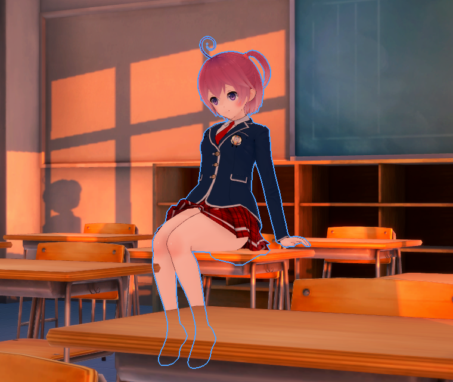

# News

`news.toml` holds the posts that Renkatsu Studio shows on its home page,
under the banner. The program reads the file from the `main` branch, so a
post is live once it is merged. Releases show up in the same list by
themselves; they need no post.

## Write a post

Add a `[[post]]` at the top of `news.toml`:

```toml
[[post]]
date = 2026-11-18
title = "Starter Content is available"
summary = "You can use Renkatsu without Koikatsu now."
url = "https://github.com/Mihnea8848/renkatsu/releases"
```

Only `date` and `title` are needed. The other keys:

| Key | What it does |
|---|---|
| `summary` | One or two lines, shown where there is no `body`. |
| `body` | The text of the post, under the title. Leave an empty line between paragraphs; the lines of one paragraph are joined. Write it as a TOML multi-line string (`"""`). |
| `url` | The page a click opens. It must be on `https://github.com/Mihnea8848/`; any other link is dropped and the post shows without one. |
| `title_ja`, `summary_ja`, `body_ja` | The Japanese version. English shows where they are missing. |
| `since` | The post shows only from this version of Renkatsu on, for example `"0.2.0"`. |
| `until` | The last day the post shows, written like `date`. |

## Pictures

A post can show what it is about. Put the picture in `images/`, beside
this file, and list it in the post's `pictures`:

```toml
pictures = [
    { file = "images/2026-11-24-pose-mode.jpg", caption = "Turning an arm", after = 2 },
]
```

`after` is the number of paragraphs of the body the picture comes after:
0 puts it before the text, and leaving it out puts it at the end. Renkatsu
0.2.2 and older ignore the key and show the post without its pictures.

Inside the body a picture can also be a paragraph of its own. Older
versions show that paragraph as text, so use it only in a post with
`since` set to a version that shows pictures:

```toml
body = """
Mirror pose flips the whole pose from one side to the other.



Copy to other side does the same for one arm or leg.
"""
```

- The caption, or the text in the brackets, shows small under the
  picture. Leave it out or empty for none.
- PNG or JPEG, at most 8 MB. An animated PNG plays, so a feature can be
  shown moving. Make one from a screen recording with
  `ffmpeg -i clip.mp4 -vf "fps=15,scale=1280:-1" -plays 0 -f apng clip.png`.
- Pictures show only in a post that is opened, never in the list.
- A picture fills the width of the text, about 760 points, but never
  shows larger than its own pixels, and never taller than the window
  leaves room for. Save screenshots at twice that width (1520 pixels)
  for sharp pictures on high-density screens.
- Give a picture a new name instead of changing one that is out: the
  program keeps the pictures it has fetched and does not fetch them again.
- Pictures pasted into a release's notes on GitHub show in the same way.
- Only pictures from this folder, on the `main` branch, and those pasted
  into releases are shown; any other address is left out.

## Rules

- Plain text, but for the pictures above and `## ` before a heading.
  Other Markdown and HTML are shown as written.
- Titles are cut at 80 characters, summaries at 200 and bodies at 16000.
- The file must stay under 64 KB, or the program ignores it.
- The page shows the eight newest entries, posts and releases together.
- Keys the program does not know are ignored, so older versions keep
  working when the format grows.

The program asks for the file at most every quarter of an hour, fetches
a post's pictures when the post is first opened, and sends nothing about
the user. The news can be turned off in Preferences.
